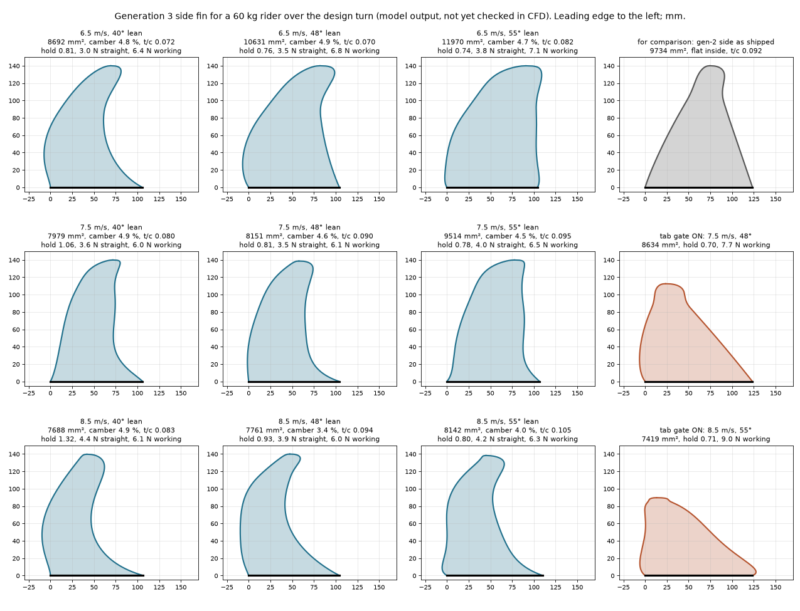

# What generation 3 makes over the design turn, and what the gates do to it (2026-11-22)

Questions. The rider gives the design turn directly (lean angle and speed, `docs/GEN3-PLAN.md` 1.0): does the side fin follow it sensibly? And a rider built from the web quiz's job carries no gate of their own, so the library's defaults apply, where the test rider's files set three of them differently: what does that change?

One rider: 60 kg, thruster side fin, PPA-CF, click tab, as the quiz would send it (`scoring="frontier"`, `hydro_model="lattice-knee"`, cambered side foil, hold target 0.80), section table of 2026-11-22. Speed 6.5, 7.5 and 8.5 m/s by lean 40°, 48° and 55°; 6 000 evaluations, two seeds a point, the better one in the table. `run_dp.py` is the script of one search, `fins/` has the better fin of every point with its margins. `outlines.png` (`draw.py`) draws them.

### Gates: the test rider's files: bending safety factor 1.5, washout 1.5 %, no tab gate

| speed m/s | lean ° | area mm² | depth mm | base mm | sweep ° | camber % | t/c at the base | knee ° | going straight N | at the working force N | hold | yaw stiffness N m/rad | roll damping N m s | bending SF with roll | tab SF | score: best seed (other) |
|---|---|---|---|---|---|---|---|---|---|---|---|---|---|---|---|---|
| 6.5 | 40 | 8692 | 140 | 106 | 26 | 4.8 | 0.072 | 8.3 | 2.98 | 6.41 | 0.81 | 142 | 0.37 | 2.37 | 0.96 | +0.01 (+0.04) |
| 6.5 | 48 | 10631 | 140 | 104 | 30 | 4.9 | 0.070 | 9.6 | 3.49 | 6.79 | 0.76 | 166 | 0.42 | 1.87 | 0.68 | +0.19 (+0.20) |
| 6.5 | 55 | 11970 | 140 | 104 | 33 | 4.7 | 0.082 | 12.3 | 3.78 | 7.14 | 0.74 | 182 | 0.47 | 1.74 | 0.50 | +0.33 (+0.36) |
| 7.5 | 40 | 7979 | 140 | 106 | 27 | 4.9 | 0.080 | 8.2 | 3.59 | 5.98 | 1.06 | 192 | 0.42 | 1.58 | 0.93 | -0.25 (-0.21) |
| 7.5 | 48 | 8151 | 139 | 104 | 23 | 4.6 | 0.090 | 8.7 | 3.53 | 6.10 | 0.81 | 187 | 0.43 | 1.54 | 0.68 | -0.08 (-0.06) |
| 7.5 | 55 | 9514 | 140 | 107 | 29 | 4.5 | 0.095 | 10.5 | 3.99 | 6.50 | 0.78 | 217 | 0.49 | 1.62 | 0.50 | +0.09 (+0.09) |
| 8.5 | 40 | 7688 | 140 | 107 | 17 | 4.9 | 0.083 | 8.4 | 4.35 | 6.07 | 1.32 | 219 | 0.48 | 1.54 | 0.91 | -0.32 (-0.31) |
| 8.5 | 48 | 7761 | 140 | 105 | 19 | 3.4 | 0.094 | 9.2 | 3.93 | 6.02 | 0.93 | 216 | 0.45 | 1.55 | 0.70 | -0.16 (-0.10) |
| 8.5 | 55 | 8142 | 138 | 110 | 18 | 4.0 | 0.105 | 9.3 | 4.24 | 6.29 | 0.80 | 228 | 0.46 | 1.51 | 0.53 | +0.02 (+0.29) |

### Gates: the library's defaults, which a quiz job gets today: bending 1.0, no washout limit, tab gate at 1.0

| speed m/s | lean ° | area mm² | depth mm | base mm | sweep ° | camber % | t/c at the base | knee ° | going straight N | at the working force N | hold | yaw stiffness N m/rad | roll damping N m s | bending SF with roll | tab SF | score: best seed (other) |
|---|---|---|---|---|---|---|---|---|---|---|---|---|---|---|---|---|
| 8.5 | 55 | 7555 | 89 | 122 | 59 | 4.8 | 0.220 | 18.6 | 4.14 | 9.54 | 0.70 | 117 | 0.09 | 34.32 | 0.99 | +3.30 (not feasible) (+4.38) |

### Gates: bending 1.5, washout 1.5 %, tab gate at 1.0

| speed m/s | lean ° | area mm² | depth mm | base mm | sweep ° | camber % | t/c at the base | knee ° | going straight N | at the working force N | hold | yaw stiffness N m/rad | roll damping N m s | bending SF with roll | tab SF | score: best seed (other) |
|---|---|---|---|---|---|---|---|---|---|---|---|---|---|---|---|---|
| 6.5 | 40 | 8542 | 139 | 110 | 26 | 5.0 | 0.072 | 8.3 | 2.98 | 6.45 | 0.80 | 133 | 0.35 | 2.47 | 1.00 | +0.03 (+0.06) |
| 7.5 | 48 | 8634 | 113 | 123 | 12 | 4.7 | 0.090 | 9.4 | 3.58 | 7.67 | 0.70 | 143 | 0.19 | 6.77 | 1.00 | +0.53 (+0.54) |
| 8.5 | 55 | 7419 | 90 | 124 | 8 | 5.0 | 0.138 | 15.4 | 4.02 | 9.04 | 0.71 | 129 | 0.10 | 14.61 | 1.00 | +1.39 (not feasible) (+4.20) |

## Reading: the design turn

- **The fin follows the turn.** The smallest fin, 7 700–8 150 mm², goes with the fast or upright turns; a hard turn at low speed asks for 10 600 mm² (6.5 m/s, 48°) and 12 000 mm² (6.5 m/s, 55°) and still falls short of the hold target (0.76, 0.74). Drag going straight follows speed (3.0–3.8, 3.5–4.0 and 3.9–4.4 N at the three speeds), drag at the working force stays between 6.0 and 7.1 N.
- **Two bounds set the planform at every point**: the depth corridor's upper edge (138–140 mm) and the base the tab set needs (104–110 mm). Together they give about 7 600 mm² as the smallest fin, and at 40° of lean and 7.5 m/s or more that fin already holds 1.06–1.32 of the peak force against a target of 0.80: the surplus is free in the score. What the search still chooses is area above that, sweep (17–33°), camber and thickness.
- **Thickness is the bending gate's.** t/c 0.07–0.08 where the safety factor is not used up (1.7–2.4, the three points at 6.5 m/s), 0.08–0.105 where it sits at 1.5–1.6.
- **Camber goes to the edge of what can be asked.** 4.5–5.0 % at seven points of nine, and 3.4–4.0 % only at 8.5 m/s with 48° and 55°. The parameter ends at 5 %; the most cambered section the referee has run is 4.5 %, and beyond it the table carries the old trend on (lift limit +0.02 to +0.05 per half percent, drag +1.5 %). Three sections at 5 % camber are running; until they are in, the last half percent is not a result.
- **Looseness and roll feel come out with the speed**, not chosen: yaw stiffness 142–228 N m/rad, roll damping 0.37–0.49 N m s.
- Seeds: the two agree within 0.06 in score at eight points; at 8.5 m/s and 55° the second is the swept stray known from every search so far (sweep 60°, +0.29). A worker has to run several seeds and keep the best.

## What the fins look like

- **Not like a fin off a shop wall.** The base is as long as the tab set needs (104–110 mm), the blade above it a slender one of 45–65 mm chord: the trailing edge cuts in by 30–50 mm within the first 30 mm of height and the leading edge stands upright or leans forward of the base. The chord itself tapers smoothly (8.5 m/s, 55°: 110, 75, 61, 52, 44 mm at 0, 27, 54, 81, 108 mm of height).
- **What draws them so.** The model pays for wetted area and for induced drag at the working force, so it wants span and little chord; the base length is a gate at one height only. The twelve edge offsets then spread the chord so that five or six strips reach the knee criterion together (shares 0.56–0.60 from 53 to 117 mm on that fin) and so that the bending gate is met: with the offsets set to zero the same fin reads hold 0.69 instead of 0.80, a knee at 7.8° instead of 9.3° and a bending safety factor of 1.21 instead of 1.51.
- **Whether a blade like this does what the model says is not known.** The criterion's share was fitted on one tunnel fin of ordinary planform; a blade shaped until every strip sits at that share is the case it has not seen, and a base flare under a concave trailing edge is three-dimensional flow no strip sees. 3-D polars of both versions of the fin for 8.5 m/s and 55° through the knee are queued (with and without the offsets, next section).

## Without the edge offsets

The same search with only the eight shape sliders and camber free (`run_sliders_only.py`, the whole budget in one stage; `fins/sliders-*.json`, drawn in `with-without-offsets.png` by `draw_with_without.py`):

| speed m/s, lean ° | | area mm² | camber % | t/c | knee ° | going straight N | at the working force N | hold | score, seeds |
|---|---|---|---|---|---|---|---|---|---|
| 8.5, 55 | sliders and camber | 8 690 | 4.5 | 0.083 | 7.9 | 4.59 | 6.40 | 0.79 | +0.08, +0.08, +0.08 (and the swept stray, +0.31) |
| | with the offsets | 8 142 | 4.0 | 0.105 | 9.3 | 4.24 | 6.29 | 0.80 | +0.02 (stray +0.29) |
| 7.5, 48 | sliders and camber | 8 889 | 4.7 | 0.071 | 7.9 | 3.79 | 6.21 | 0.80 | −0.03, −0.01 |
| | with the offsets | 8 151 | 4.6 | 0.090 | 8.7 | 3.53 | 6.10 | 0.81 | −0.08, −0.06 |
| 6.5, 48 | sliders and camber | 10 577 | 4.8 | 0.070 | 9.9 | 3.44 | 6.78 | 0.76 | +0.19, +0.20 |
| | with the offsets | 10 631 | 4.9 | 0.070 | 9.6 | 3.49 | 6.79 | 0.76 | +0.19, +0.20 |

- **Without the offsets the fin is an ordinary one**: raked 26–29°, a full tip, a trailing edge that hollows above a base of 104 mm.
- **The offsets are worth 0.00 to 0.06 of score**: 0.35 N going straight and 0.1 N at the working force at most, a tenth of a felt step, and 0.01 of hold.
- That is less than a rider feels, and it comes from shaping the chord to a criterion fitted on one ordinary fin. Since 2026-11-22 the search leaves the offsets alone under frontier scoring (`RiderSpec.edge_offsets`, on again by asking; every shipped generation-2 result keeps them).
- The sliders park too: depth at the corridor's edge (140 mm), base at the tab minimum (104 mm), tip width at its upper bound (0.60 of the base) on every seed. The first two are named above; the wide tip is the same pull as the offsets', lower loading where the criterion looks, within what eight sliders can do.

## Reading: the gates

- **The tab gate decides the fin from about 7.5 m/s and 48° up.** With it at 1.0 the search cuts the root moment the only way it can: depth 113 mm and base 123 mm at 7.5 m/s and 48°, depth 90 mm and base 124 mm at 8.5 m/s and 55°. Hold drops to the floor, drag at the working force rises from 6.1 to 7.7 N and from 6.3 to 9.0 N (half a step and one step), roll damping falls from 0.43 and 0.46 to 0.19 and 0.10 N m s. On the library's defaults the fin of 8.5 m/s and 55° is that one too, not feasible on either seed.
- **Without it the fins sit at a tab safety factor of 0.50–0.96 on the same model.** The test rider's shipped side fins are 140 mm deep and read 0.53; they are in use. The comment at `RiderSpec.tab_sf_min` calls the tab model the wrong tool for a gate and describes this exploit; `docs/FEM-BENCH.md` keeps the gate on outside the envelope it was checked in, because what it guards against is a tab snapping at the deck.
- **The bending safety factor is the other one.** The default is 1.0, his files have 1.3 to 1.7; at 1.5 it sets the thickness at five of nine points.
- This is `docs/GEN3-PLAN.md` decision D13: which gates a rider from the quiz gets.

## What this is not

One weight, one hold target, two seeds, and the model's own numbers throughout: no fin here has been run in CFD. The depth corridor is a convention the model does not argue with (it wants span). The map says how the present model answers the present inputs, and where its bounds and gates do the designing.
