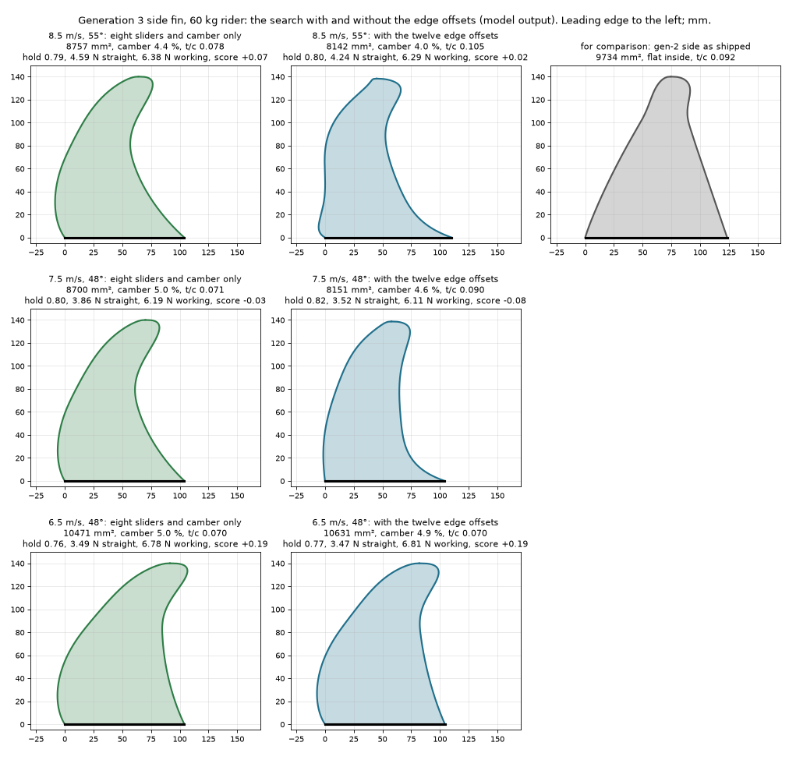

# What generation 3 makes over the design turn, and what gates and bounds do to it (2026-11-22)

Questions. The rider gives the design turn directly (lean angle and speed, `docs/GEN3-PLAN.md` 1.0): does the side fin follow it sensibly? What does the fin look like? And a rider built from the web quiz's job carries no gate of their own, so the library's defaults apply, where the test rider's files set three of them differently: what does that change?

One rider: 60 kg, thruster side fin, PPA-CF, click tab, as the quiz would send it (`scoring="frontier"`, `hydro_model="lattice-knee"`, cambered side foil, hold target 0.80), section table of 2026-11-22. Speed 6.5, 7.5 and 8.5 m/s by lean 40°, 48° and 55°; 6 000 evaluations, two seeds a point (four for the present search: the map was run on the table before and after its last three sections went in, and every fin is scored here on the table as shipped), the best one in the tables. `run_dp.py` is the script of one search, `fins/` has the better fin of every point with its margins (`sliders-…`: as the library searches now; `offsets-…`: with the twelve edge offsets, the library before this day; `omar-…`, `default-…`: with the tab gate on). `outlines.png` (`draw.py`) and `with-without-offsets.png` (`draw_with_without.py`) draw them.

### Gates: the test rider's files (bending safety factor 1.5, washout 1.5 %, no tab gate), searched as the library does now: no edge offsets

| speed m/s | lean ° | area mm² | depth mm | base mm | sweep ° | camber % | t/c at the base | knee ° | going straight N | at the working force N | hold | yaw stiffness N m/rad | roll damping N m s | bending SF with roll | tab SF | score: best seed (other) |
|---|---|---|---|---|---|---|---|---|---|---|---|---|---|---|---|---|
| 6.5 | 40 | 8804 | 140 | 104 | 27 | 5.0 | 0.071 | 7.9 | 3.02 | 6.46 | 0.80 | 142 | 0.37 | 2.74 | 0.98 | +0.04 (+0.04, +0.04, +0.04) |
| 6.5 | 48 | 10471 | 140 | 104 | 33 | 5.0 | 0.070 | 9.7 | 3.49 | 6.78 | 0.76 | 165 | 0.41 | 1.87 | 0.69 | +0.19 (+0.19, +0.20, +0.21) |
| 6.5 | 55 | 12148 | 140 | 104 | 22 | 4.5 | 0.081 | 12.1 | 3.74 | 7.18 | 0.74 | 177 | 0.47 | 1.68 | 0.50 | +0.35 (+0.36, +0.37, +0.39) |
| 7.5 | 40 | 7788 | 140 | 104 | 23 | 4.6 | 0.080 | 6.9 | 3.35 | 5.92 | 0.90 | 187 | 0.40 | 1.50 | 0.97 | -0.19 (-0.19, -0.19, -0.19) |
| 7.5 | 48 | 8700 | 140 | 104 | 27 | 5.0 | 0.071 | 7.8 | 3.86 | 6.19 | 0.80 | 191 | 0.42 | 1.97 | 0.71 | -0.03 (-0.02, -0.01, -0.01) |
| 7.5 | 55 | 10723 | 140 | 104 | 25 | 3.6 | 0.078 | 10.2 | 4.08 | 6.68 | 0.77 | 232 | 0.50 | 1.50 | 0.51 | +0.17 (+0.17, +0.17, +0.17) |
| 8.5 | 40 | 7889 | 140 | 104 | 19 | 4.0 | 0.080 | 7.6 | 4.06 | 6.02 | 1.16 | 224 | 0.46 | 1.50 | 0.95 | -0.27 (-0.27, -0.26, -0.26) |
| 8.5 | 48 | 8137 | 140 | 104 | 22 | 3.0 | 0.083 | 8.2 | 4.02 | 6.09 | 0.88 | 243 | 0.46 | 1.50 | 0.69 | -0.10 (-0.10, -0.10, -0.09) |
| 8.5 | 55 | 8757 | 140 | 104 | 25 | 4.4 | 0.078 | 8.1 | 4.59 | 6.38 | 0.79 | 243 | 0.48 | 1.50 | 0.53 | +0.07 (+0.07, +0.08, +0.31) |

### Gates: the same gates, searched with the twelve edge offsets (the library before 2026-11-22)

| speed m/s | lean ° | area mm² | depth mm | base mm | sweep ° | camber % | t/c at the base | knee ° | going straight N | at the working force N | hold | yaw stiffness N m/rad | roll damping N m s | bending SF with roll | tab SF | score: best seed (other) |
|---|---|---|---|---|---|---|---|---|---|---|---|---|---|---|---|---|
| 6.5 | 40 | 8692 | 140 | 106 | 26 | 4.8 | 0.072 | 8.4 | 2.96 | 6.43 | 0.82 | 142 | 0.37 | 2.37 | 0.96 | +0.01 (+0.04) |
| 6.5 | 48 | 10631 | 140 | 104 | 30 | 4.9 | 0.070 | 9.8 | 3.47 | 6.81 | 0.77 | 166 | 0.42 | 1.87 | 0.68 | +0.19 (+0.20) |
| 6.5 | 55 | 11970 | 140 | 104 | 33 | 4.7 | 0.082 | 12.4 | 3.76 | 7.15 | 0.75 | 182 | 0.47 | 1.74 | 0.50 | +0.33 (+0.36) |
| 7.5 | 40 | 7979 | 140 | 106 | 27 | 4.9 | 0.080 | 8.5 | 3.56 | 5.99 | 1.08 | 192 | 0.42 | 1.58 | 0.93 | -0.25 (-0.21) |
| 7.5 | 48 | 8151 | 139 | 104 | 23 | 4.6 | 0.090 | 8.7 | 3.52 | 6.11 | 0.82 | 187 | 0.43 | 1.54 | 0.68 | -0.08 (-0.06) |
| 7.5 | 55 | 9514 | 140 | 107 | 29 | 4.5 | 0.095 | 10.5 | 3.99 | 6.50 | 0.79 | 217 | 0.49 | 1.62 | 0.50 | +0.09 (+0.09) |
| 8.5 | 40 | 7688 | 140 | 107 | 17 | 4.9 | 0.083 | 8.6 | 4.32 | 6.09 | 1.34 | 219 | 0.48 | 1.54 | 0.91 | -0.32 (-0.31) |
| 8.5 | 48 | 7761 | 140 | 105 | 19 | 3.4 | 0.094 | 9.1 | 3.93 | 6.02 | 0.93 | 216 | 0.45 | 1.55 | 0.70 | -0.16 (-0.10) |
| 8.5 | 55 | 8142 | 138 | 110 | 18 | 4.0 | 0.105 | 9.3 | 4.24 | 6.29 | 0.80 | 228 | 0.46 | 1.51 | 0.53 | +0.02 (+0.29) |

### Gates: the library's defaults, which a quiz job gets today: bending 1.0, no washout limit, tab gate at 1.0

| speed m/s | lean ° | area mm² | depth mm | base mm | sweep ° | camber % | t/c at the base | knee ° | going straight N | at the working force N | hold | yaw stiffness N m/rad | roll damping N m s | bending SF with roll | tab SF | score: best seed (other) |
|---|---|---|---|---|---|---|---|---|---|---|---|---|---|---|---|---|
| 8.5 | 55 | 7555 | 89 | 122 | 59 | 4.8 | 0.220 | 19.4 | 4.14 | 9.55 | 0.72 | 117 | 0.09 | 34.32 | 0.99 | +3.29 (not feasible) (+4.37) |

### Gates: bending 1.5, washout 1.5 %, tab gate at 1.0

| speed m/s | lean ° | area mm² | depth mm | base mm | sweep ° | camber % | t/c at the base | knee ° | going straight N | at the working force N | hold | yaw stiffness N m/rad | roll damping N m s | bending SF with roll | tab SF | score: best seed (other) |
|---|---|---|---|---|---|---|---|---|---|---|---|---|---|---|---|---|
| 6.5 | 40 | 8542 | 139 | 110 | 26 | 5.0 | 0.072 | 8.5 | 2.96 | 6.47 | 0.81 | 134 | 0.35 | 2.47 | 1.00 | +0.03 (+0.06) |
| 7.5 | 48 | 8634 | 113 | 123 | 12 | 4.7 | 0.090 | 9.5 | 3.56 | 7.68 | 0.71 | 143 | 0.19 | 6.77 | 1.00 | +0.54 (+0.54) |
| 8.5 | 55 | 7419 | 90 | 124 | 8 | 5.0 | 0.138 | 15.8 | 4.00 | 9.06 | 0.72 | 129 | 0.10 | 14.61 | 1.00 | +1.39 (not feasible) (+4.20) |

## Reading: the design turn (first table)

- **The fin follows the turn.** 7 800–8 800 mm² for the fast or upright turns, 10 500–10 700 mm² at 6.5 m/s with 48° and at 7.5 m/s with 55°, 12 100 mm² at 6.5 m/s with 55°. The three hardest turns for their speed stay short of the hold target (0.74–0.77). Drag going straight follows speed (3.0–3.7, 3.4–4.1 and 4.0–4.6 N at the three speeds), drag at the working force stays between 5.9 and 7.2 N.
- **They are fins**: raked 19–33°, a full tip, a trailing edge that hollows above the base.
- **Every one is 140 mm deep on a 104 mm base with a tip 0.60 of the base wide.** Those are the depth corridor's upper edge, the base the tab set needs and the tip-width slider's upper limit. Together they give about 7 800 mm² as the smallest fin, and at 40° of lean and 7.5 m/s or more that fin already holds 0.90–1.16 of the peak force against a target of 0.80: the surplus is free in the score.
- **Thickness is the bending gate's**: t/c 0.070–0.083, with the safety factor at its limit of 1.5 at five points and unused (1.7–2.7) at four.
- **Camber goes to the edge of what can be asked where the load is low.** 5.0 % at three points (6.5 m/s with 40° and 48°, 7.5 m/s with 48°), 4.4–4.6 % at three, 3.0–4.0 % at three. The parameter ends at 5 %. The most cambered sections the referee had run were at 4.5 %; three at 5 % were run the same day and are in the table these fins are scored on (`../section-tables/rerun-held/`): the lift limit goes on rising to the edge, 0.04–0.05 per half percent.
- **Looseness and roll feel come out with the speed**, not chosen: yaw stiffness 142–243 N m/rad, roll damping 0.37–0.50 N m s.
- Seeds: the four agree within 0.04 in score at every point, within 0.02 at seven, but for one at 8.5 m/s and 55°, the swept stray known from every search so far (sweep 60°, +0.31). A worker has to run several seeds and keep the best.

## With the edge offsets (second table)

- **Until this day the search also moved twelve edge offsets, and nobody had drawn the result.** The fins were slender blades on a base flare: the base as long as the tab set needs, above it a blade of 45–65 mm chord, the trailing edge cut in by 30–50 mm within the first 30 mm of height, the leading edge upright or leaning forward of the base.
- **What drew them so.** The model pays for wetted area and for induced drag at the working force, so it wants span and little chord; the base length is a gate at one height only. The offsets then spread the chord so that five or six strips reach the knee criterion together (at 8.5 m/s and 55°: shares 0.56–0.60 from 53 to 117 mm of height) and so that the bending gate is met. With the offsets of that fin set to zero it reads hold 0.69 instead of 0.80, a knee at 7.8° instead of 9.3° and a bending safety factor of 1.21 instead of 1.51.
- **What they were worth: 0.00 to 0.08 of score**, point by point against the first table. At most 0.4 N going straight and 0.2 N at the working force, a tenth of a felt step, and 0.01–0.03 of hold where hold is short of its target (up to 0.16 where it is in surplus and does not count).
- That is less than a rider feels, and it comes from shaping the chord to a criterion fitted on one tunnel fin of ordinary planform; a base flare under a hollow trailing edge is also three-dimensional flow no strip sees. Since 2026-11-22 the search leaves the offsets alone under frontier scoring (`RiderSpec.edge_offsets`; on again by asking; every shipped generation-2 result keeps them). The shipped gen-2 planform carrying the foil of the 8.5 m/s, 55° fin reads 4.9 N going straight, 6.9 N at the working force and hold 0.74: the foil is the large lever, the planform a fraction of a step.
- 3-D polars of both versions of the fin for 8.5 m/s and 55° through the knee are queued.

## Where each dimension of that fin comes from

One slider moved at a time around the fin first found without offsets for 8.5 m/s and 55° (`sweep_sliders.py`; depth 140 mm, base 104 mm, sweep 26°, tip width 0.60 of the base, 4.5 % camber, t/c 0.083; on the table before its last three sections, which scores that fin the same):

| moved | values | knee ° | hold | going straight N | at the working force N | what stops it |
|---|---|---|---|---|---|---|
| tip width, share of the base | 0.25, 0.35, 0.45, 0.55, **0.60** | 4.8, 5.9, 6.7, 7.5, 7.9 | 0.55, 0.63, 0.68, 0.75, 0.79 | 4.2 … 4.6 | 6.1 … 6.4 | the slider's upper limit (0.60) |
| depth mm | 120, 130, **140**, 150, 160 | 8.6, 8.2, 7.9, 7.6, 7.4 | 0.66, 0.72, 0.79, 0.85, 0.91 | 3.9, 4.2, 4.6, 4.9, 5.3 | 6.6, 6.4, 6.4, 6.5, 6.6 | the depth corridor (140) |
| base mm | 95, **104**, 112, 120 | 7.5, 7.9, 8.3, 8.7 | 0.72, 0.79, 0.84, 0.90 | 4.3, 4.6, 4.9, 5.1 | 6.2, 6.4, 6.7, 6.9 | the tab set's minimum base (104) |
| sweep ° | 10, 20, **26**, 32, 40 | 7.6, 7.7, 7.9, 8.2, 9.1 | 0.74, 0.77, 0.79, 0.80, 0.83 | 4.4 … 4.9 | 6.2 … 6.9 | the washout limit of 1.5 %, on both sides |

- **Every dimension of the fin is set by a gate or a bound**: depth by the corridor, base by the tabs, tip width by its slider's limit, sweep by the washout limit, thickness by the bending safety factor. Camber and the two edge-shape sliders are what the score chooses.
- **Tip width is the model's strongest lever on hold**: from 0.25 to 0.60 of the base the knee goes from 4.8° to 7.9° and hold from 0.55 to 0.79, for 0.4 N going straight. A narrow tip loads its outer strips and they reach the criterion first. That is what taper does to a wing, and the size of it here is the criterion's: no two polars on record differ in tip width alone. A twin of this fin with the tip at 0.35 is queued beside it.
- **Depth beyond the corridor would not be taken far**: at 150 mm hold is past its target and going straight costs 0.35 N more, so the score is about level between 140 and 150 mm.
- **The washout limit decides the sweep** to within a few degrees, from his file for the big-wave set (1.5 %; his other files have 5 %).

## Reading: the gates

- **The tab gate decides the fin from about 7.5 m/s and 48° up.** With it at 1.0 the search cuts the root moment the only way it can: depth 113 mm and base 123 mm at 7.5 m/s and 48°, depth 90 mm and base 124 mm at 8.5 m/s and 55°. Hold drops to the floor, drag at the working force rises from 6.2 to 7.7 N and from 6.4 to 9.0 N (half a step and most of one), roll damping falls from 0.42 and 0.48 to 0.19 and 0.10 N m s. On the library's defaults the fin of 8.5 m/s and 55° is that one too, not feasible on either seed.
- **Without it the fins sit at a tab safety factor of 0.50–0.98 on the same model.** The test rider's shipped side fins are 140 mm deep and read 0.53; they are in use. The comment at `RiderSpec.tab_sf_min` calls the tab model the wrong tool for a gate and describes this exploit; `docs/FEM-BENCH.md` keeps the gate on outside the envelope it was checked in, because what it guards against is a tab snapping at the deck.
- **The bending safety factor is the other one.** The default is 1.0, his files have 1.3 to 1.7; at 1.5 it sets the thickness at five of nine points.
- This is `docs/GEN3-PLAN.md` decision D13: which gates a rider from the quiz gets.

## What this is not

One weight, one hold target, two seeds, and the model's own numbers throughout: no fin here has been run in CFD. The depth corridor is a convention the model does not argue with (it wants span). The map says how the present model answers the present inputs, and where its bounds and gates do the designing.

